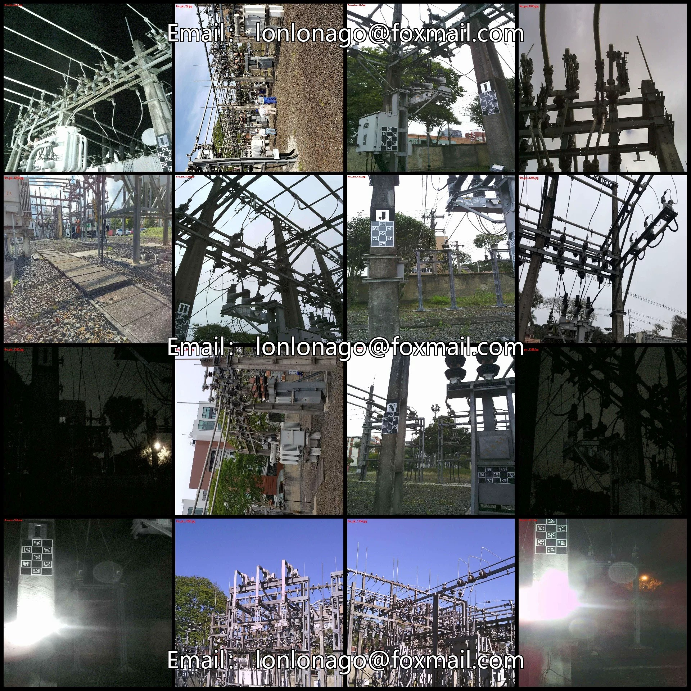
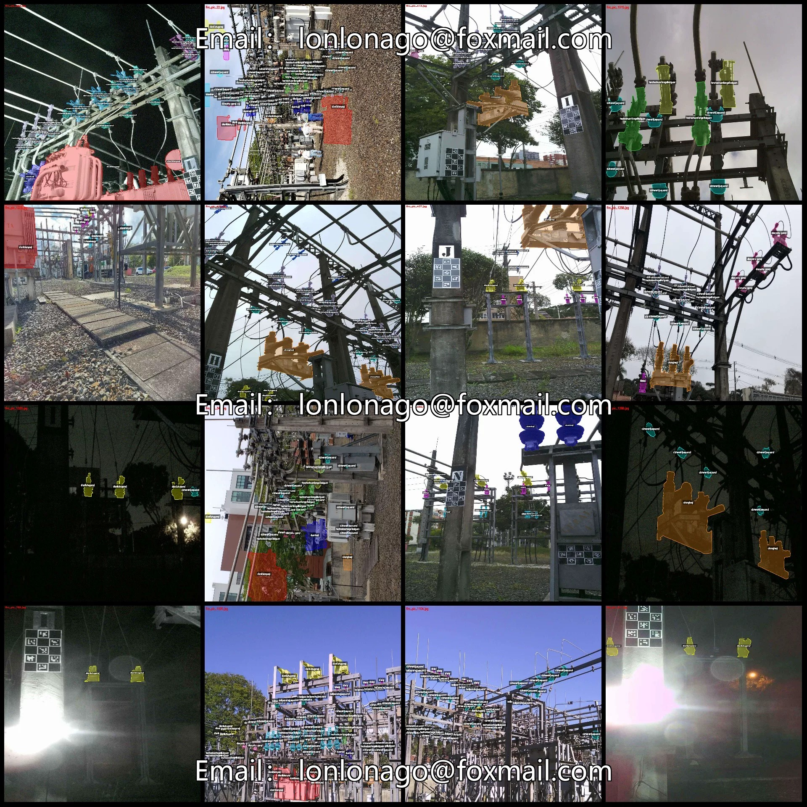
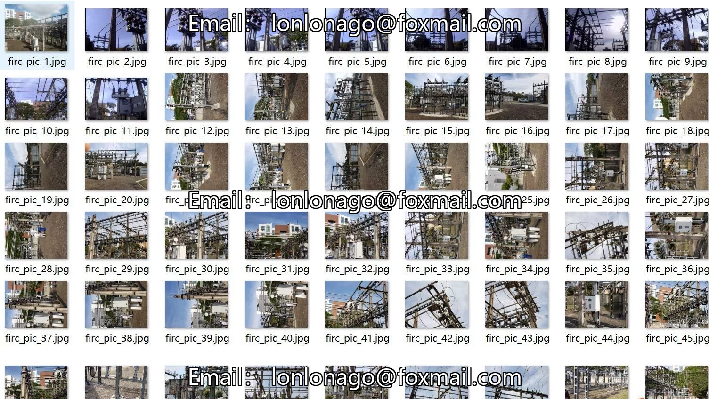
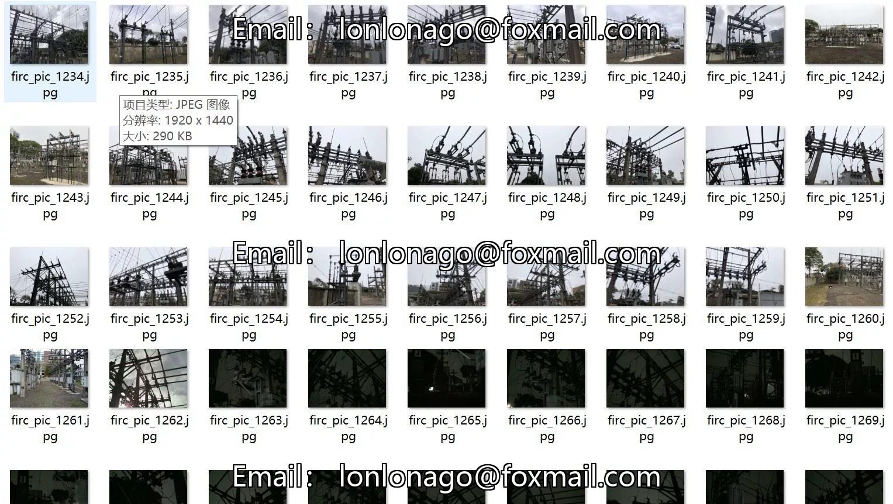
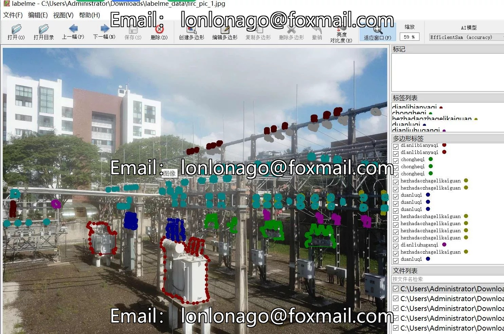
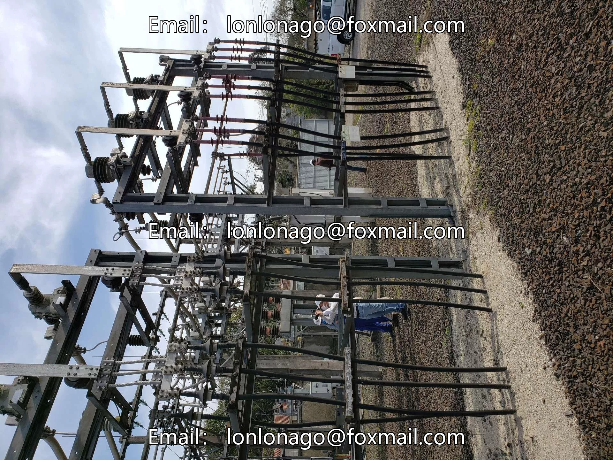
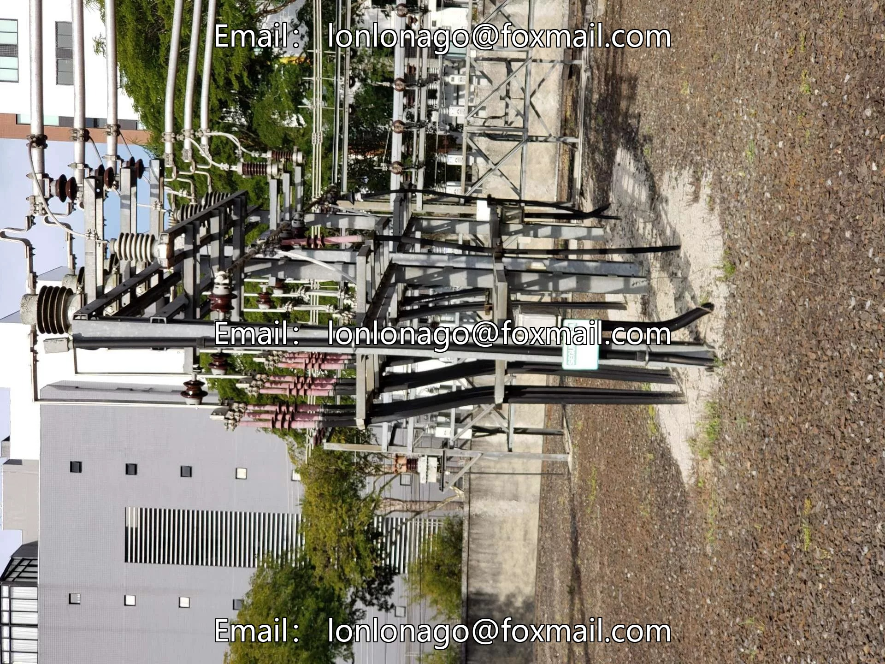

# Power scenario substation equipment identification key component recognition segmentation dataset labelme grid

## Body

Power Scene Substation Device Identification Key Parts Segmentation Dataset - LabelMe Format - 1660 Categories
Warm Reminder: Due to the dataset's replicability, please confirm compliance with requirements before purchasing.
Dataset Format: LabelMe format (excluding mask files, only including jpg images and corresponding json files)
Number of Images (Number of jpg files): 1660
Number of Annotations (Number of json files): 1660
Number of Annotation Categories: 15

Label category names: ["bileiqi", "bolipanxingjueyuanzi", "chongheqi", "cizhenshijueyuanzi", "dianlibianyaqi", "dianliuhuganqi", "dianyahu ganqi", "duanluqi", "fenzhachuanliangelikaiguan", "fenzhadaozhagelikaiguan", "hezhachuanliangelikaiguan", "hezhadaozhagelikaiguan", "rongd"]

Unexpected Query: "uanqigelikaiguan","sanligelikaiguan","xiaoshengqi"

["Fuse", "Glass disk insulator", "Recloser", "Ceramic needle insulator", "Power transformer", "Current transformer", "Voltage transformer", "Breaker", "Disconnecting switch in series", "Disconnecting switch with knife switch", "Connecting switch in series", "Connecting switch with knife switch", "Fuse disconnecting switch", "Tripolar disconnecting switch", "Muffler"]
Number of boxes and the number of images occupied by each category
Bileiqi box count = 1974, occupying picture count = 537
Bolipanxingjueyuanzi frame count = 3180, occupy image count = 739

Chongheqi frame count = 2330, occupied image count = 861
Cizhenshijueyuanzi frame count = 26450, occupied image count = 1413
Dianlibianyaqi frame count = 768, occupied image count = 406
Dianliuhuganqi frame count = 2128, occupied image count = 707
Dianyahu ganqi frame count = 651, occupied image count = 275
Dunluiqi frame count = 980, occupied image count = 367
Fenzhachuanliangelikaiguan frame count = 1596, occupied image count = 243

Frames = 308, Pictures = 84
Hezhachuanliangelikaiguan frame count = 957, occupying image count = 274
hezhadaozhagelikaiguan frame count = 5225, occupying image count = 1066
Rongduanqigelikaiguan frame count = 355, occupying image count = 156
Sanligelikaiguan frame count = 2348, occupying image count = 231
Xiaoshengqi frame count = 1354, occupying picture count = 197
Total frames: 50604

Using labeling tool: labelme=5.5.0
Image resolution: 1920x2560
Labeling rules: Polygons are drawn around the categories.
Important Note: The dataset can be opened and edited using labelme, but JSON datasets need to be converted into mask or Yolo format or COCO format for semantic segmentation or instance segmentation.
Special : This dataset does not guarantee the accuracy of the trained models or weight files.

## Images

## Payment

Here is a pay link on Stripe ( https://buy.stripe.com/3cs8yP7sY87d0vu9AB ). Please contact me lonlonago@foxmail.com after funding $89, and I will send you a complete data files , thank you!

